<picture>
  <source media="(prefers-color-scheme: light)" srcset="docs/assets/hero-light.svg">
  
</picture>

<h1 align="center">tagit</h1>

<p align="center">
  <b>De vrais tags pour les morceaux que vous avez déjà.</b><br>
  Une commande cherche chaque fichier sur Deezer, Apple, MusicBrainz et LRCLIB, montre ce qui changerait, et l'écrit quand vous dites oui.
</p>

<p align="center">
  <a href="#installation"></a>
  &nbsp;
  <a href="#utilisation"></a>
  &nbsp;
  <a href="#configuration"></a>
</p>

<p align="center">
  
  
  
  <a href="https://github.com/adrbn/tagit/releases/latest"></a>
  <a href="LICENSE"></a>
</p>

<p align="center">
  Libre et gratuit · macOS et Linux · ffmpeg facultatif, pour ReplayGain
  <br><br>
  <a href="README.md">English</a> · <b>Français</b>
</p>

---

tagit est un tagueur en ligne de commande pour les fichiers musicaux achetés, rippés ou téléchargés avec des tags maigres ou faux. Il retrouve la sortie dont vient le morceau, remplit les champs qu'une bibliothèque musicale utilise vraiment, et n'écrit rien que vous n'ayez vu avant. Les sources sont des API publiques, sans compte ni clé.

## Ce qu'il fait

- **Retrouve la sortie.** Cherche sur Deezer avec les tags du fichier, ou son nom (`01 - Artiste - Titre.mp3`), ou la requête que vous lui donnez. Chaque résultat est noté sur le titre, l'artiste et la durée ; entre deux résultats presque à égalité, la sortie la plus ancienne gagne, donc un single passe devant la compilation qui l'a repris.
- **Remplit les champs.** Titre, artistes, artiste de l'album, album, numéros de piste et de disque, date et date d'origine, genre, type de sortie, label, numéro de catalogue, copyright, ISRC, code-barres, pays, BPM, mention explicite et identifiants MusicBrainz (enregistrement, sortie, groupe de sorties, artistes).
- **Ramène la pochette.** Celle d'Apple en 1400 × 1400, sinon celle de Deezer. Une pochette déjà présente n'est remplacée que par une plus grande.
- **Ajoute les paroles.** Depuis LRCLIB, synchronisées (LRC) quand elles existent, en texte brut sinon. Les instrumentaux sont ignorés.
- **Mesure le volume.** Gain et crête de piste ReplayGain 2.0 par le compteur EBU R128 de ffmpeg, plus le gain d'album pour les singles. Les fichiers Opus reçoivent des gains R128 à la place.
- **Demande d'abord.** Chaque champ s'affiche en actuel → nouveau. Répondez `y` pour écrire, `c` pour choisir un autre résultat, `s` pour chercher à nouveau, `e` pour modifier un champ, `q` pour quitter.
- **Envoie le fichier, si vous le voulez.** Avec une cible configurée, un fichier tagué peut être copié sur un serveur par scp, par exemple dans un dossier que surveille un importeur de bibliothèque.

Formats : MP3, WAV et AIFF (ID3v2.4), FLAC, Ogg Vorbis et Opus (commentaires Vorbis), M4A/ALAC (atomes MP4). Les noms de champs suivent ceux de MusicBrainz Picard : Navidrome, Plex, Jellyfin, beets et la plupart des lecteurs les lisent.

## Installation

**pipx** (tout système avec Python 3.9+) :

```sh
pipx install git+https://github.com/adrbn/tagit
```

**Homebrew** (macOS, Linux) :

```sh
brew install adrbn/tap/tagit
```

**Depuis les sources :**

```sh
git clone https://github.com/adrbn/tagit
cd tagit
python3 -m pip install .
```

Pour ReplayGain, installez aussi ffmpeg (`brew install ffmpeg`, `apt install ffmpeg`). Sans lui, tagit tague tout le reste ; passez `--no-gain` pour sauter la mesure.

## Prérequis

- Python 3.9 ou plus récent. Les dépendances s'installent avec : [mutagen](https://github.com/quodlibet/mutagen), certifi, et tomli avant Python 3.11.
- ffmpeg, facultatif, pour ReplayGain.
- scp et ssh, seulement si vous utilisez l'envoi.

## Utilisation

```sh
tagit morceau.mp3                     # cherche, montre les changements, demande avant d'écrire
tagit ~/Musique/Nouveautés            # chaque fichier audio d'un dossier, sous-dossiers compris
tagit -n morceau.flac                 # essai à blanc : montre ce qui a été trouvé, n'écrit rien
tagit -y ~/Musique/Nouveautés         # écrit sans demander les résultats à 70 % ou plus
tagit -q "Artiste - Titre" fichier.m4a  # cherche ceci plutôt que ce que dit le fichier
tagit --no-gain morceau.mp3           # saute la mesure ReplayGain
```

| Option | Effet |
|---|---|
| `-n`, `--dry-run` | Montre ce qui a été trouvé, n'écrit rien |
| `-y`, `--yes` | Écrit sans demander les résultats sûrs (70 % ou plus) ; saute les autres |
| `-q`, `--query "Artiste - Titre"` | Cherche ceci plutôt que les tags ou le nom du fichier |
| `--no-gain` | Ne mesure pas ReplayGain |
| `--send` | Après l'écriture, envoie vers la cible configurée sans demander |
| `--no-send` | Ne propose jamais l'envoi |
| `--version` | Affiche la version |

Dans la liste des changements, `+` marque un champ que le fichier n'a pas encore, `~` un champ qui change, `=` un champ déjà juste, et `(kept)` un champ que les sources n'ont pas rempli, laissé tel quel. L'interface de tagit est en anglais.

## Configuration

Rien n'est à configurer pour taguer. Le seul réglage concerne l'envoi facultatif, lu dans `~/.config/tagit/config.toml` (ou `$XDG_CONFIG_HOME/tagit/config.toml`, ou le chemin donné par `TAGIT_CONFIG`) :

```toml
[send]
# où copier les fichiers tagués : utilisateur@hôte:/dossier/absolu (syntaxe scp)
target = "moi@nas.local:/srv/musique/arrivees"
# le nom affiché dans les questions (par défaut : l'hôte)
name = "le NAS"
# après la copie, recule la date de modification du fichier de ce nombre de minutes (touch GNU sur le serveur) ; 0 = ne rien toucher
backdate_minutes = 0
# une ligne affichée après chaque envoi réussi
note = "l'importeur le prend sous 10 minutes"
```

`TAGIT_SEND_TARGET` remplace `target`. Sans cible, tagit ne propose jamais l'envoi. Avec une cible, tagit demande `send to le NAS? [Y/n]` après chaque fichier écrit ou déjà à jour ; `--send` saute la question et `--no-send` saute l'étape.

Un envoi copie le fichier sous un nom caché `.tagit-….part`, puis le renomme sur le serveur une fois complet, en `Morceau (2).mp3` si `Morceau.mp3` existe déjà : un dossier surveillé ne voit jamais un fichier à moitié copié. ssh tourne avec `BatchMode=yes` et demande donc une connexion par clé. Reculer la date aide les importeurs qui ignorent les fichiers modifiés depuis quelques minutes, comme une tâche cron qui attend la fin des téléchargements.

## Compiler depuis les sources

```sh
git clone https://github.com/adrbn/tagit && cd tagit
python3 tests/test_tagit.py    # de simples asserts, ou : python3 -m pytest
python3 tagit.py -n un-morceau.mp3
```

tagit tient en un fichier, `tagit.py`. Les illustrations du README sont générées par `python3 docs/make_svgs.py` à partir de deux vraies sorties de terminal, gardées dans `docs/assets/readme-src/`.

## Confidentialité

tagit envoie le titre, l'artiste, l'album, la durée et l'ISRC du morceau aux services cités dans les crédits pour le chercher, et rien d'autre. Pas de compte, pas de télémétrie. L'audio ne quitte jamais votre machine, sauf si vous configurez une cible d'envoi.

## Soutenir

tagit est gratuit. S'il vous a épargné une soirée à corriger des tags, vous pouvez m'offrir un café :

<a href="https://ko-fi.com/adrbn"></a>

Une étoile sur le dépôt aide d'autres personnes à le trouver.

## Licence

MIT : vous pouvez l'utiliser, le modifier et le partager librement en gardant la mention de copyright. Voir [LICENSE](LICENSE).

## Crédits

- [API Deezer](https://developers.deezer.com/api) : recherche, sortie, ISRC, UPC, label, BPM, pochette
- [API iTunes Search d'Apple](https://performance-partners.apple.com/search-api) : genre, copyright, graphie de l'artiste, pochette 1400 px
- [MusicBrainz](https://musicbrainz.org/doc/MusicBrainz_API) : identifiants d'enregistrement, de sortie et d'artistes par ISRC, détails de la sortie
- [LRCLIB](https://lrclib.net) : paroles synchronisées et en texte brut
- [mutagen](https://github.com/quodlibet/mutagen) lit et écrit les tags ; [FFmpeg](https://ffmpeg.org) mesure le volume

<sub>tagit n'est affilié ni à Deezer, ni à Apple, ni à la MetaBrainz Foundation, ni à LRCLIB. Merci de respecter les conditions d'utilisation de chaque service.</sub>
